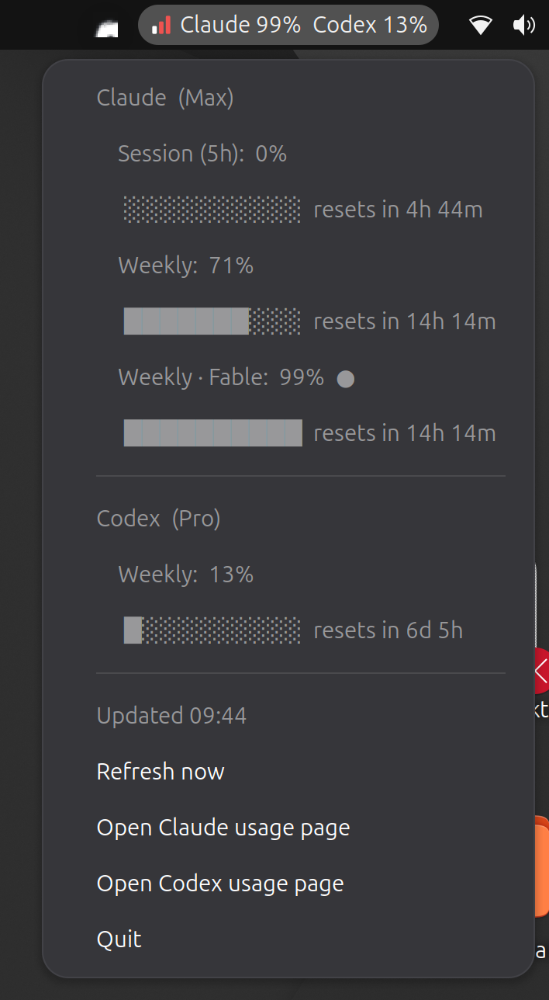
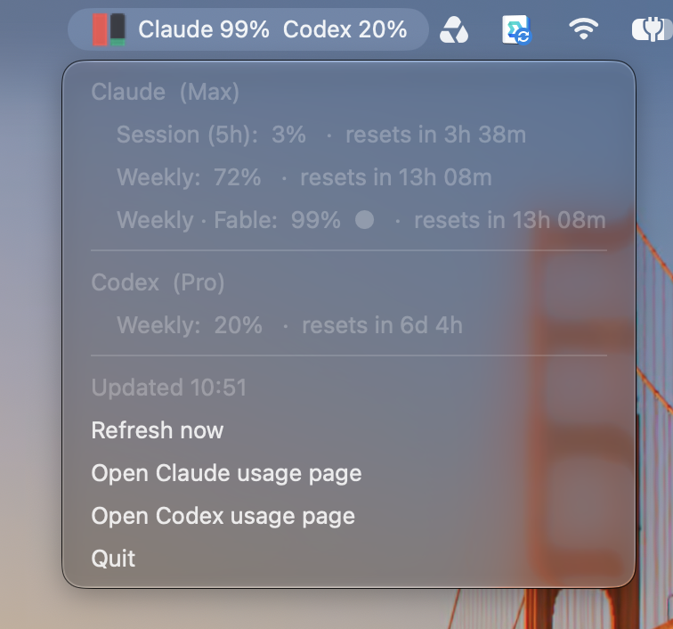
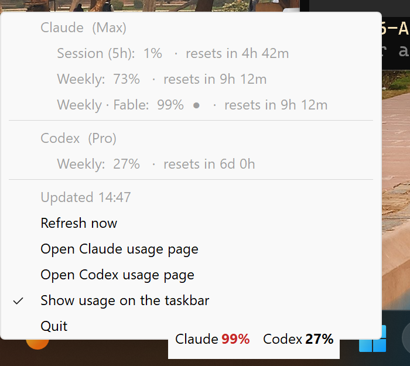

# LLM Usage Widget

Shows your **Claude** and **Codex** plan usage limits (session / weekly windows, model-scoped
limits, and time until each resets) where your system status icons live:

| Linux (Ubuntu) | macOS | Windows |
|---|---|---|
|  |  |  |

| OS | Where it appears | What it shows |
|---|---|---|
| Linux | Top bar / panel, next to Wi-Fi and sound (AppIndicator) | Icon + `Claude 99%  Codex 13%`; click for details |
| macOS | Menu bar, top right | Gauge icon + `Claude 99%  Codex 13%`; click for details |
| Windows | An empty spot on the taskbar, plus a tray icon | `Claude 99%  Codex 13%` on the taskbar and a two-bar gauge icon; click either for details |

The dropdown lists every limit with its percentage and reset countdown, plus *Refresh now*,
links to each provider's usage page, and *Quit*. Bars and icons turn amber at 75% and red at 90%
(or whatever severity the provider reports). If a refresh fails, the last numbers are kept and marked stale.

There is also a floating always-on-top window (`--widget`) for desktops without a tray.

It reuses the logins that **Claude Code** (`claude`) and the **Codex CLI** (`codex`) already store
on your machine, so there is nothing to configure. Credentials are only read, never modified, and each
token is sent only to the provider that issued it.

| Provider | Credentials read from | Endpoint |
|---|---|---|
| Claude | macOS Keychain `Claude Code-credentials`, else `~/.claude/.credentials.json` (`$CLAUDE_CONFIG_DIR`) | `api.anthropic.com/api/oauth/usage` |
| Codex  | `~/.codex/auth.json` (`$CODEX_HOME`) | `chatgpt.com/backend-api/wham/usage` |
| Bedrock | Your AWS credentials (profile, SSO, env vars), via boto3 | AWS Budgets, Cost Explorer, CloudWatch |

> These are the same internal endpoints the official CLIs use for their `/usage` and `/status`
> screens. They are undocumented and may change; if a provider shows an error after an update,
> check the parser for that provider in `usage_widget.py`.

## Install

First log in to each CLI once with your subscription: `claude` → `/login`, and `codex login`.
Each installer puts the app where it belongs for the OS, starts it right away, and starts it again
every time you log in.

### Option 1: packaged installers (no Python needed on macOS / Windows)

Download from the GitHub release (built by `.github/workflows/build-installers.yml`):

| OS | File | Notes |
|---|---|---|
| Linux (Debian/Ubuntu) | `llm-usage-widget_<ver>_all.deb` | `sudo apt install ./llm-usage-widget_*.deb`. Starts right away for every logged-in user, and at login via `/etc/xdg/autostart`. |
| macOS | `LLM-Usage-Widget-<ver>-macos-arm64.pkg` (Apple Silicon) or `-x86_64.pkg` (Intel) | Installs `/Applications/LLM Usage.app` plus a login LaunchAgent. Release builds are signed with a Developer ID and notarized by Apple. |
| Windows | `LLM-Usage-Widget-<ver>-windows-setup.exe` | Per-user install, no admin rights needed. "Start automatically when I sign in" is ticked by default. The build is unsigned, so SmartScreen may warn: click **More info → Run anyway**. Uninstall from *Settings → Apps*, the *Uninstall LLM Usage Widget* Start Menu entry, or by running `LLM-Usage-Widget-<ver>-windows-uninstall.exe` from the same release (add `/VERYSILENT` to skip the prompts). Settings in `%APPDATA%\llm-usage-widget` are kept. |

To uninstall the macOS package, open `LLM-Usage-Widget-<ver>-macos-uninstall.pkg` from the same release
(it asks for an administrator password), or run the copy of the uninstaller inside the app:

```sh
sudo "/Applications/LLM Usage.app/Contents/Resources/uninstall.sh"
```

Either one stops the widget for every logged-in user and removes the app, its LaunchAgent and the
package receipt. Settings in `~/Library/Application Support/llm-usage-widget` are left in place.

On Debian/Ubuntu: `sudo apt remove llm-usage-widget`.

### Option 2: install scripts (from a checkout of this repo)

| OS | Install | Uninstall |
|---|---|---|
| Linux / macOS | `./install.sh` | `./install.sh --uninstall` |
| Windows | double-click `install.cmd` (or `powershell -ExecutionPolicy Bypass -File install.ps1`) | `uninstall.cmd` |

- **Linux:** copies to `~/.local/share/llm-usage-widget`, adds an app-menu launcher and
  `~/.config/autostart/llm-usage-widget.desktop`. Uses the system Python's PyGObject and AppIndicator
  (preinstalled on Ubuntu; the script prints the package command for your distro if they're missing).
  On GNOME the AppIndicator extension must be enabled (the default on Ubuntu; elsewhere install
  "AppIndicator and KStatusNotifierItem Support"). KDE, XFCE, Cinnamon and others work out of the box,
  though some panels show only the icon, not the text label.
- **macOS:** needs Python 3.9+ (python.org or Homebrew). Copies to
  `~/Library/Application Support/llm-usage-widget` with its own virtualenv and registers
  `~/Library/LaunchAgents/local.llm-usage-widget.plist`. Logs go to `~/Library/Logs/llm-usage-widget.log`.
- **Windows:** needs Python 3.9+ from python.org. Copies to `%LOCALAPPDATA%\llm-usage-widget` with its
  own virtualenv and adds Start Menu and Startup shortcuts.

On macOS the first run may ask for Keychain access to `Claude Code-credentials`; choose *Always Allow*.
On Windows the numbers are drawn on the taskbar itself: left of the `^` arrow when there is room, otherwise in
the next empty gap (with centered taskbar buttons, usually left of Start), on two smaller lines if that is what
fits. It never covers taskbar buttons; if the taskbar is completely full it hides until there is room. Windows has
no API for text in the taskbar, so this is a small always-on-top window that follows the taskbar and steps
aside for full-screen apps and an auto-hidden or vertical taskbar. Turn it off with *Show usage on the taskbar*
in the menu. The tray icon may be tucked into the overflow (`^`) menu; drag it onto the taskbar to keep it visible.

### Running from source

```sh
/usr/bin/python3 usage_widget.py               # Linux (system Python, for PyGObject)
python3 -m pip install -r requirements.txt     # macOS / Windows: pystray + Pillow
python3 usage_widget.py                         # Windows: pythonw usage_widget.py (no console window)
```

Only one copy runs at a time; starting a second one exits immediately.

## Options

```sh
usage_widget.py                  # tray / top bar / menu bar (default)
usage_widget.py --widget         # floating always-on-top window instead
usage_widget.py --widget --framed    # ...with a normal title bar
usage_widget.py --once           # print usage in the terminal and exit
usage_widget.py --interval 300   # refresh every 5 minutes (default 180 s, min 60 s)
```

### Expired logins

Claude Code and Codex refresh their own tokens while you use them. If you haven't used one for a while,
its access token may expire and the widget will say so. Open that CLI once and the widget picks up the
new token on its next refresh. The widget deliberately does not refresh tokens itself, because rotating
the refresh token would log the CLI out.

## Known issue: Ubuntu with GNOME 50

The Ubuntu AppIndicators extension shipped with GNOME 50 comes up half-broken at login: until it is
reloaded, apps that start after its initial bus scan get `No such method "RegisterStatusNotifierItem"`
and don't appear (this also hits Remmina, update-notifier, etc.). Apps already running during that scan
*do* appear, so starting the widget at login usually works. `install.sh` detects the broken state and
reloads the extension once so the icon appears immediately. If the icon is missing, reload it by hand:

```sh
gnome-extensions disable ubuntu-appindicators@ubuntu.com && gnome-extensions enable ubuntu-appindicators@ubuntu.com
```

## Building the installers

The GitHub Actions workflow builds every installer on its own OS. Push a tag matching `__version__` in
`usage_widget.py` (e.g. `v1.0.0`) to build them and attach them to a release, or run the workflow
by hand to download them as build artifacts. To build locally on each OS:

```sh
packaging/linux/build-deb.sh                                   # Linux → dist/*.deb
python3 -m pip install pyinstaller -r requirements.txt
packaging/macos/build-pkg.sh                                   # macOS → dist/*.pkg
powershell -File packaging\windows\build.ps1                   # Windows → dist\*-setup.exe (needs Inno Setup 6)
```

To sign the macOS build locally, set `CODESIGN_IDENTITY` (a "Developer ID Application" identity) and
`INSTALLER_SIGN_IDENTITY` ("Developer ID Installer"). The app is signed with the hardened runtime and a
secure timestamp, which is what notarization requires. Then notarize and staple the pkg:

```sh
xcrun notarytool submit dist/*.pkg --keychain-profile <profile> --wait
xcrun stapler staple dist/*.pkg
```

In CI, the macOS job signs, notarizes and staples the pkg when these repository secrets are set. A tag
release fails without them:

| Secret | Contents |
| --- | --- |
| `MAC_CERT_P12_BASE64` / `MAC_CERT_PASSWORD` | The Developer ID Application certificate and private key, as a base64-encoded `.p12`, and its export password |
| `MAC_INSTALLER_CERT_P12_BASE64` / `MAC_INSTALLER_CERT_PASSWORD` | The same for the Developer ID Installer certificate |
| `AC_API_KEY_P8_BASE64` / `AC_API_KEY_ID` / `AC_API_ISSUER_ID` | An App Store Connect API key (the base64-encoded `.p8`), its key ID and issuer ID, used by `notarytool` |

### Code signing (Windows)

The workflow Authenticode-signs `LLMUsageWidget.exe` and the setup `.exe` with
[Azure Trusted Signing](https://learn.microsoft.com/azure/artifact-signing/) (the same setup as
Virux), timestamps both, and checks the signatures before uploading. A tag build fails rather than
publish an unsigned installer; a manual run without the secrets builds unsigned with a warning.
It needs these repository (or organization) secrets:

| Secret | What it is |
|---|---|
| `AZURE_TENANT_ID` | Entra ID tenant of the app registration that signs |
| `AZURE_CLIENT_ID` | That app registration's client ID |
| `AZURE_CLIENT_SECRET` | A client secret for it; also how the workflow decides whether to sign |
| `AZ_TS_ENDPOINT` | The Trusted Signing account's regional endpoint, e.g. `https://eus.codesigning.azure.net` |
| `AZ_TS_ACCOUNT` | Trusted Signing account name |
| `AZ_TS_PROFILE` | Certificate profile name |

The app registration needs the *Trusted Signing Certificate Profile Signer* role on the account.

**Publisher name only, no address.** Windows shows the certificate's common name, the validated
organization name ("Aleph Void LLC"), as the publisher in SmartScreen, the UAC prompt and the file's
*Digital Signatures* tab. Create the **Public Trust** certificate profile with *Include street
address* and *Include postal code* both **unticked** (the default) so the certificate carries no
address. City, state and country are always part of a Public Trust certificate's details and can't
be removed. `packaging/windows/verify-signature.ps1` fails the build if a signature is invalid,
not timestamped, or its certificate includes a street address or postal code. Run it on a
downloaded installer to check it yourself:

```powershell
powershell -File packaging\windows\verify-signature.ps1 .\LLM-Usage-Widget-<ver>-windows-setup.exe
```

The release's `-windows-uninstall.exe` is signed the same way. The uninstaller that Inno Setup
writes into the install folder at install time is not signed. It runs without elevation
(the install is per-user), so Windows doesn't show a publisher prompt for it.

## Amazon Bedrock (and bedrock-mantle)

If Claude Code or Codex runs on Amazon Bedrock instead of a subscription, there are no session or weekly
limits to show. Instead the widget adds a **Bedrock** section that shows:

- **Budget:** spend against an [AWS Budget](https://console.aws.amazon.com/billing/home#/budgets) as a
  percentage bar that resets with the budget period. This only appears if you name a budget (see below).
- **This month:** month-to-date spend for every service with "Bedrock" in its name, from Cost Explorer.
  Third-party models such as Claude are billed as Marketplace services named like
  `Claude Sonnet 4.5 (Amazon Bedrock Edition)`, and these are included.
- **Tokens today:** input and output tokens since local midnight, from CloudWatch. This covers both the
  `bedrock-runtime` endpoint (`AWS/Bedrock`) and the OpenAI/Anthropic-compatible `bedrock-mantle` endpoint
  (`AWS/BedrockMantle`).

The section turns on automatically when Claude Code's settings set `CLAUDE_CODE_USE_BEDROCK`
(or an `ANTHROPIC_BASE_URL` containing `bedrock`), or when a `base_url` in `~/.codex/config.toml` points at
Bedrock. The AWS profile and region come from the same place: `AWS_PROFILE` and `AWS_REGION` in Claude
Code's `env` block, or the region in Codex's `base_url`. In that case the Claude or Codex section
is hidden if that CLI has no subscription login. To override any of this, add a `bedrock` entry to
`config.json` in the widget's config folder (`~/.config/llm-usage-widget/` on Linux,
`~/Library/Application Support/llm-usage-widget/` on macOS, `%APPDATA%\llm-usage-widget\` on Windows):

```json
{
  "bedrock": {
    "profile": "work",
    "regions": ["us-east-1", "us-west-2"],
    "budget": "bedrock-monthly",
    "cost_explorer": true,
    "cost_interval": 21600,
    "metrics_interval": 900
  }
}
```

Use `"bedrock": true` to turn the section on with the defaults, or `false` to hide it.

This needs **boto3**: it is in `requirements.txt` and in the macOS and Windows packages. On Linux, run
`sudo apt install python3-boto3` (or install it for the system Python another way). The IAM identity
needs `ce:GetCostAndUsage`, `cloudwatch:GetMetricData`, and, for a budget, `budgets:ViewBudget` and
`sts:GetCallerIdentity`. If a permission is missing, only that row shows an error. If the credentials
have expired (for example an SSO session), the section says to run `aws sso login`.

**Cost:** Cost Explorer charges $0.01 per request and its data only updates a few times a day, so spend
(and the budget) is fetched at most every `cost_interval` seconds (6 h by default, about $1.20 a month).
Token counts are fetched every `metrics_interval` seconds (15 min). Both are cached in
`bedrock-cache.json` next to `config.json`, so restarts don't refetch them, and *Refresh now* doesn't
bypass the cache either. Billing data can lag by a day or more, so don't treat this as a spending alarm.

## Adding a provider

Write a `fetch_<name>()` that returns a `ProviderUsage` and add it to `PROVIDERS`, then add tests for
it under `tests/` (see `tests/test_codex.py` for the pattern: canned responses, no network).

## Running the tests

```sh
python3 -m pip install -r requirements-dev.txt
python3 -m pytest                  # Linux without a display: xvfb-run -a python3 -m pytest
python3 -m pytest --cov            # with a coverage report
```

The tests never touch the network or your real logins: each one runs against an empty temporary home
directory, and the provider APIs, AWS, GTK/AppIndicator, pystray and Win32 are faked. The Tk tests are
skipped when there is no display. GitHub Actions runs the suite on every pull request and push to `main`
(`.github/workflows/tests.yml`) on Linux, macOS and Windows with Python 3.9 to 3.14, plus Ruff and
ShellCheck, and installs the `.deb` on Ubuntu to run the tests on the system Python.

## License

MIT. See [LICENSE](LICENSE).
